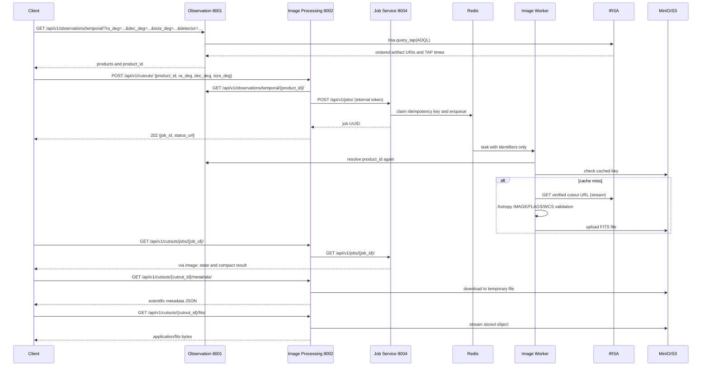
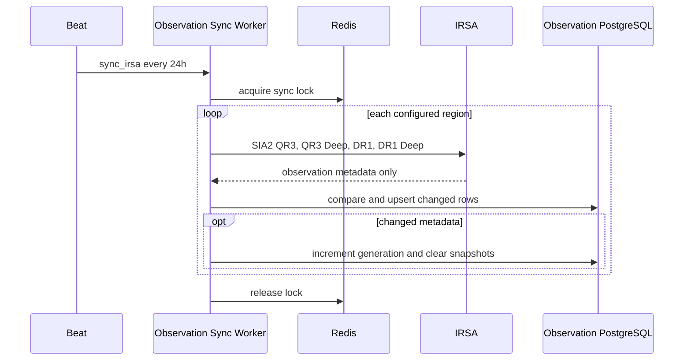

# Backend workflow: sky position to inspected FITS

1. The client sends ICRS RA/Dec and either a circular radius or circular FOV diameter to Observation's SIA2 search. Observation checks Redis and PostgreSQL snapshots, then IRSA on a miss. The temporal TAP search does the same for RA/Dec, `size_deg` and detector; TAP returns sorted products with the original `time_bounds_lower` value and stores provenance in Observation's database.
2. The client POSTs a TAP `product_id` and the same position/size to Image Processing. Image Processing reads that product over Observation's API, verifies the TAP-proven position and the IRSA URL, and asks Job Service to submit an idempotent Celery task.
3. Job Service stores a Redis idempotency key, enqueues only identifiers and numeric parameters, and returns a UUID. Image Processing returns HTTP 202 with a job status URL.
4. The Image worker resolves the product again from Observation, checks S3 for an existing cutout, streams IRSA bytes to a bounded temporary file, validates the FITS with Astropy and stores it in MinIO/S3. It writes compact provenance to the Image database and returns the internal S3 key to Celery's result backend.
5. The client polls Image's job status proxy. On success, it requests `GET /api/v1/cutouts/{cutout_id}/metadata/`; Image retrieves the S3 object to a temporary file, computes metadata and WCS values, and returns compact JSON. It never sends pixel arrays or FITS bytes in JSON. The separate `/api/v1/cutouts/{cutout_id}/fits/` endpoint streams the binary FITS from S3 for a viewer.



## API examples

Observation temporal request:

```http
GET /api/v1/observations/temporal/?ra_deg=210.80227&dec_deg=54.34895&size_deg=0.1&detector=SPHEREx-D2&limit=10
```

A product has `product_id`, `artifact_uri`, `cutout_url`, `time_bounds_lower`, the original query coordinates, `size_deg`, and `detector`. The exact count and time vary with IRSA releases.

Image Processing submission:

```http
POST /api/v1/cutouts/
Content-Type: application/json

{"product_id":"<64-character hash from TAP result>","ra_deg":210.80227,"dec_deg":54.34895,"size_deg":0.1}
```

Response: `202 {"job_id":"<UUID>","status_url":"/api/v1/cutouts/jobs/<UUID>/"}`. Polling returns `pending`, `running`, `succeeded` or `failed` plus a compact `result` containing `cutout_id`, `object_key`, and `metadata_url` after success. Metadata returns the source URL, original TAP observation time value and structured `fits` object. The `fits.header_date` field is not the observation timestamp.

The Job Service accepts only the allowlisted cutout task and requires `X-EON-Internal-Token` for submission. The Image API handles that internal call; clients should use the Image endpoint. All services publish OpenAPI at `/api/v1/schema/` and Swagger at `/api/v1/docs/`.

## Daily metadata sync (Process B)

Beat enqueues `sync_irsa` every 24 hours. A single-concurrency Observation worker locks the run in Redis, queries the four QR3/DR1 wide/deep collections for each configured sky region, bulk compares records by publisher DID, and updates only affected metadata. Any changed region increments the durable PostgreSQL cache generation and clears query snapshots; subsequent reads use new Redis key namespaces. No cutout or FITS download occurs in this path. Reprocessing a file is visible as a changed access URL/processing-version value. The selected regions define the sync coverage; no full-sky claim is made.




## BE-02 processing boundary (hackathon)

The existing cutout flow above remains available. The new application use case is
`ProcessTimelapse.execute(TimelapseRequest(...))`; its Celery adapter is
`eon.image_processing.render_timelapse` on the image_processing queue. BE-03 supplies
job_id and temporal product IDs, owns submission/state/progress and consumes the
returned `{job_id, status: "completed", frames}` manifest. The current Jobs HTTP
allowlist has not been changed; integrating the new task/payload belongs to BE-03.

Image Processing resolves every reference through Observation HTTP, validates the
exact query geometry/detector and IRSA URL, downloads bounded server-side cutouts,
verifies FITS acquisition times, aligns IMAGE on a common TAN grid, and renders PNG
with one shared asinh scale. It uploads source FITS and PNGs via the existing S3
port, then persists the JSON manifest last. Errors propagate to the caller; no
completed result is returned after a failed upload. Partial objects can remain for
a retry/cleanup policy owned by orchestration/storage operations.

MinIO is an independent development container; native Windows uses
S3_ENDPOINT_URL=http://127.0.0.1:9000. No FITS bytes travel in JSON/Celery, and no
Observation or Jobs database is accessed by this processing path. See
[BE02_MVP.md](BE02_MVP.md) for request/schema, limits, startup and verified evidence.


## Optional Compose storage

For the Compose alternative to the independent local MinIO container, see
[Compose MinIO setup](COMPOSE_MINIO.md). It uses a pinned community server image,
non-root storage, guarded empty-volume ownership setup and a bounded boto3 bucket
initializer. Internal clients keep `http://minio:9000`; Windows host clients use
the published host port. Isolated storage validation does not start or replace
the existing independent PostgreSQL, Redis or MinIO containers.
